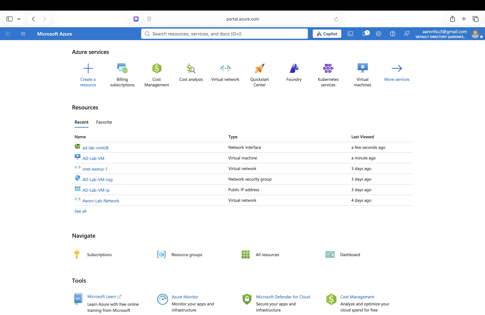
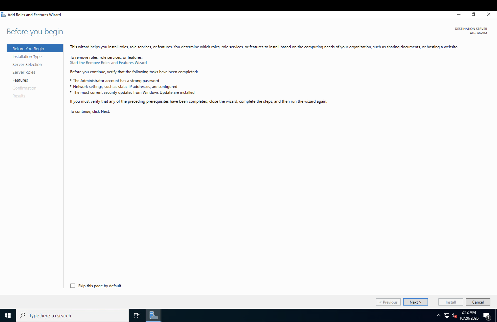
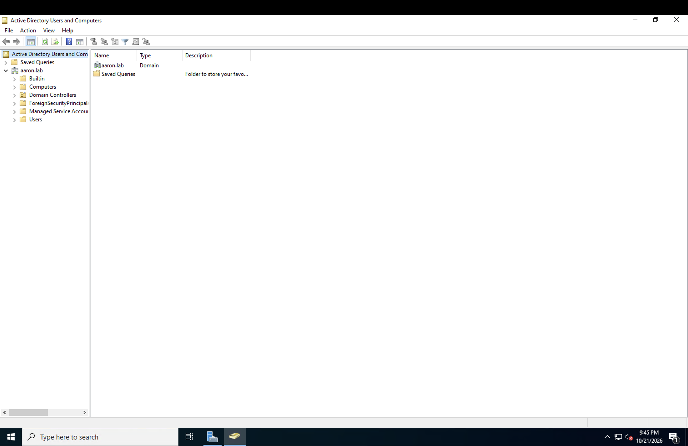
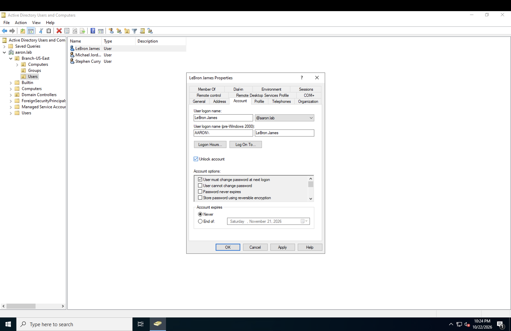
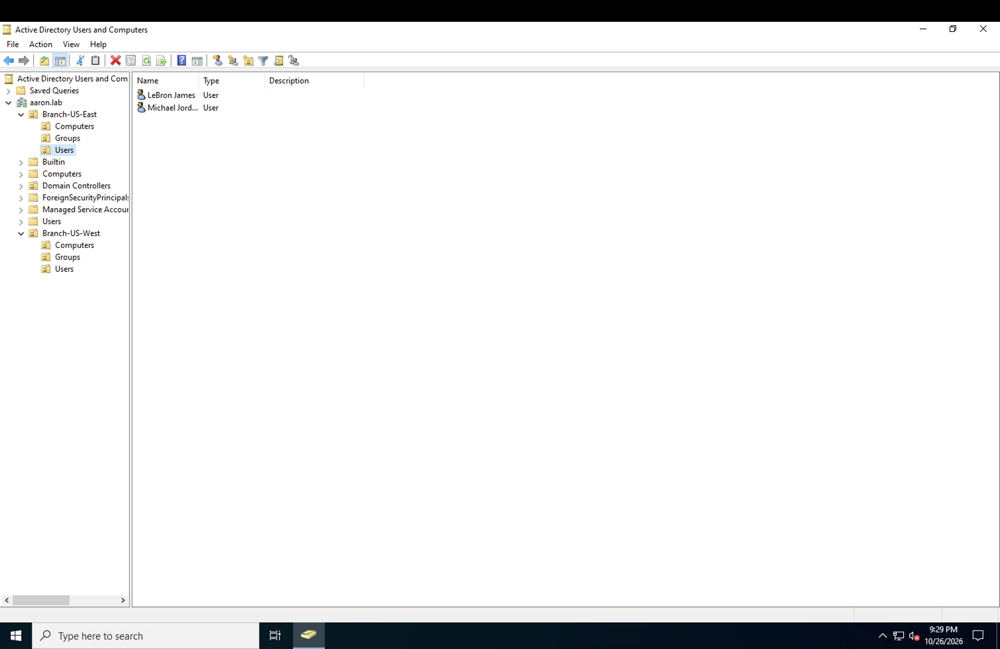
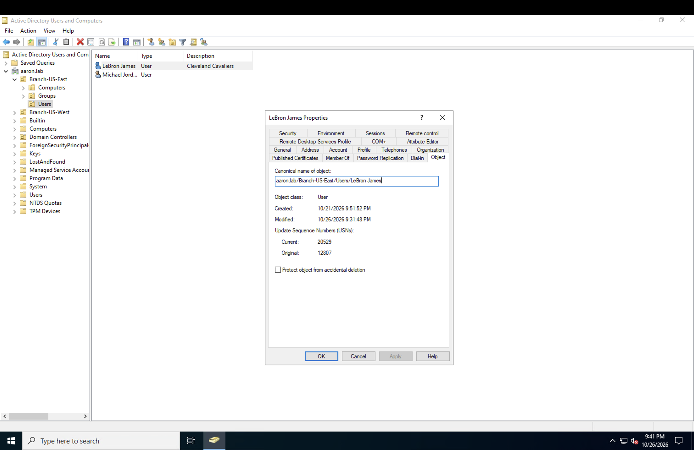
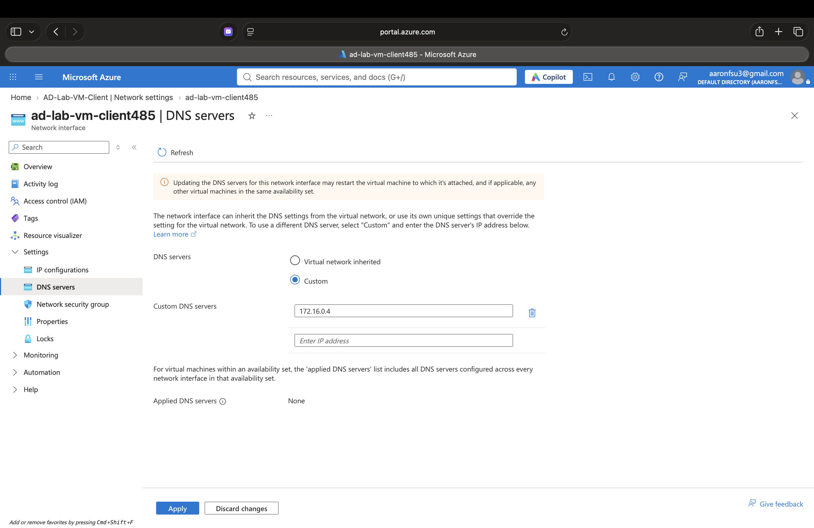
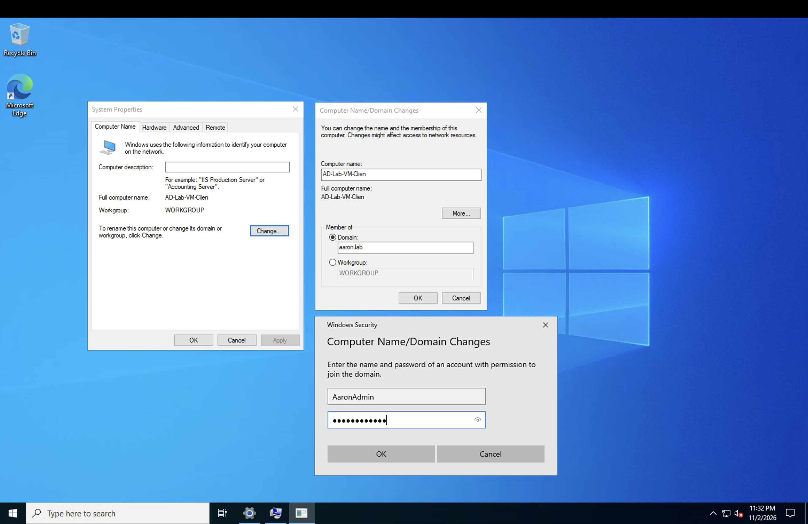
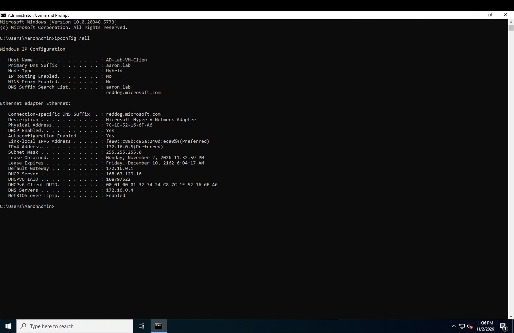

# Active-Directory-Lab - * In Progress *
Created an Active Directory domain controller to practice managing users and devices

<!-- put pics in own folder? 
also put description above all?
do pics as paths over url?
take dash out of title n alt
check all pics there
decide if take any pics out
any take out of images folder like ds store?
-->

 

   

   

   

   

   

   

   

   

   

   

   

   

   

   

   

   

   

   

   

   

   

   

   

   

   

   

   

   

   

   
