# Active-Directory-Lab - * In Progress *
Created an Active Directory domain controller to practice managing users and devices

<!-- put pics in own folder? 
also put description above all?
do pics as paths over url?
take dash out of title n alt
check all pics there
decide if take any pics out
any take out of images folder like ds store?
take out last br spacings?
-->

 

Domain IP Address

   

Microsoft Azure

   

Cost Analysis

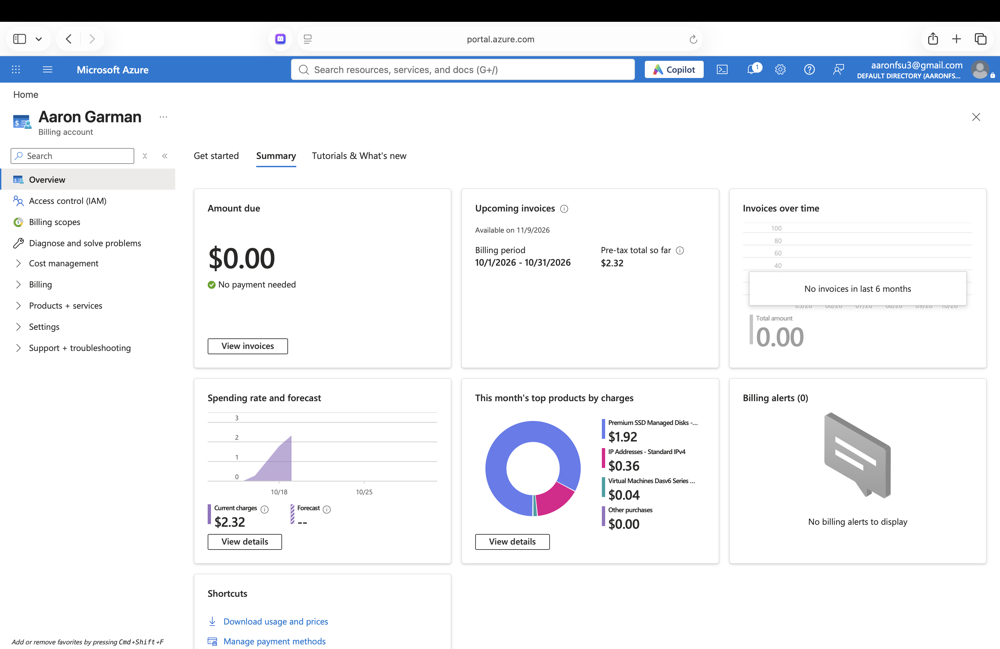

   

Create Server VM

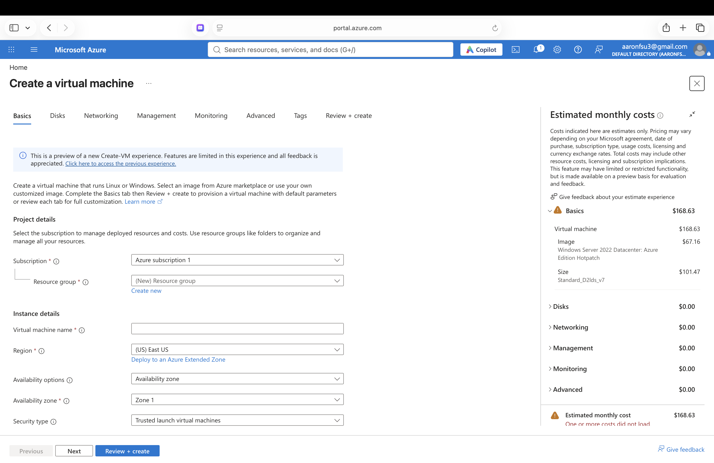

   

Install Server Roles

   

Server Roles Wizard

   

Restart Apply Roles

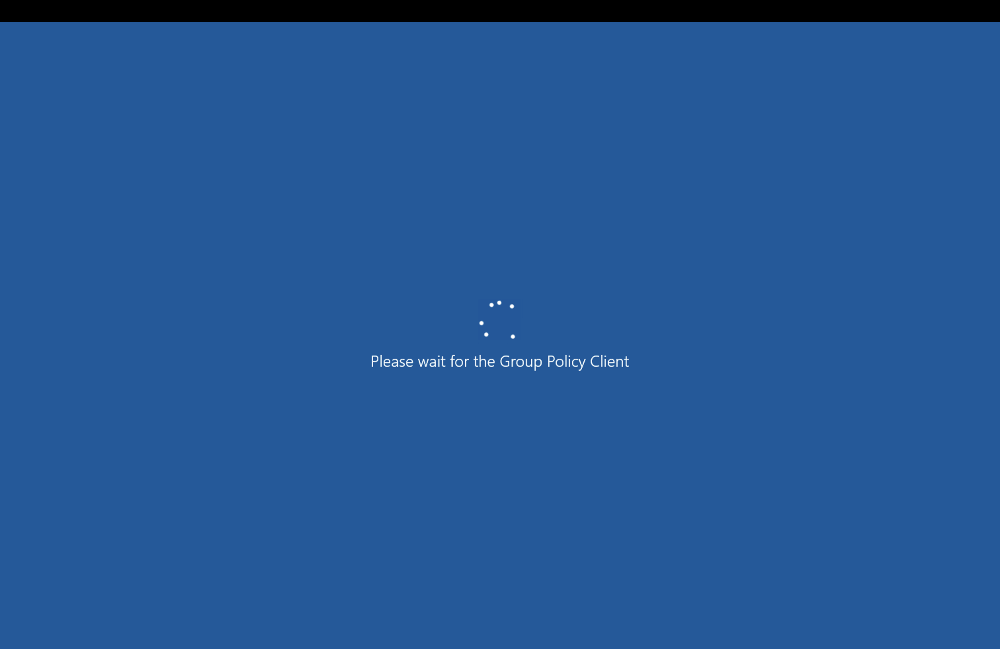

   

Initial Domain Controller

   

Find Host PC

   

Domain Controller Groups

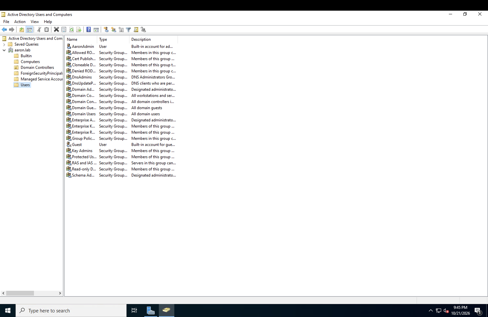

   

Create User

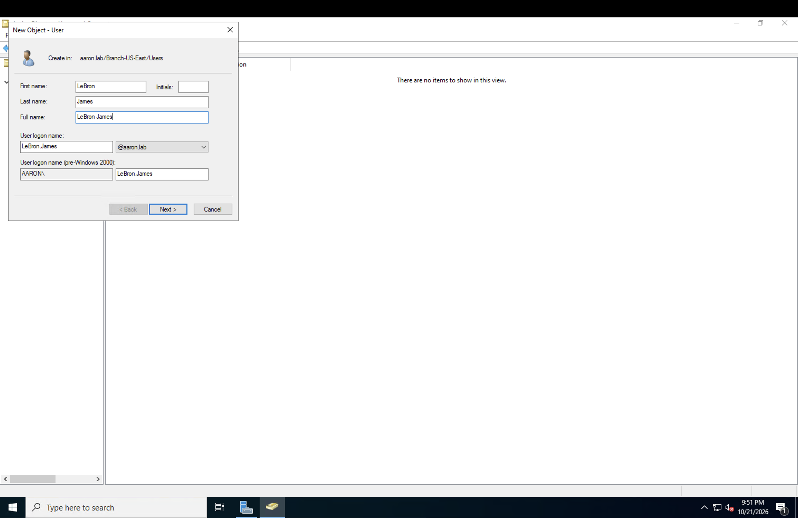

   

User Created

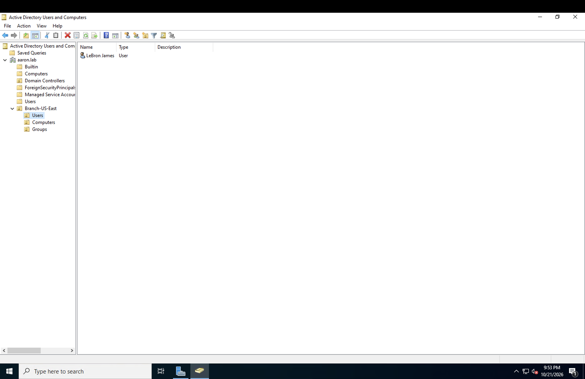

   

Attribute Editor

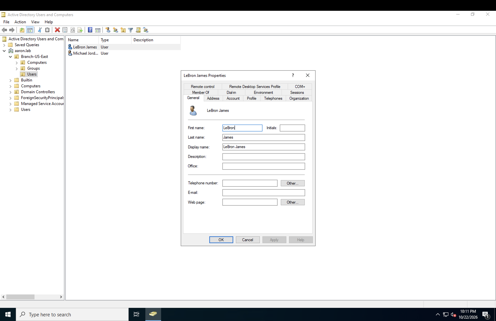

   

Reset User Password

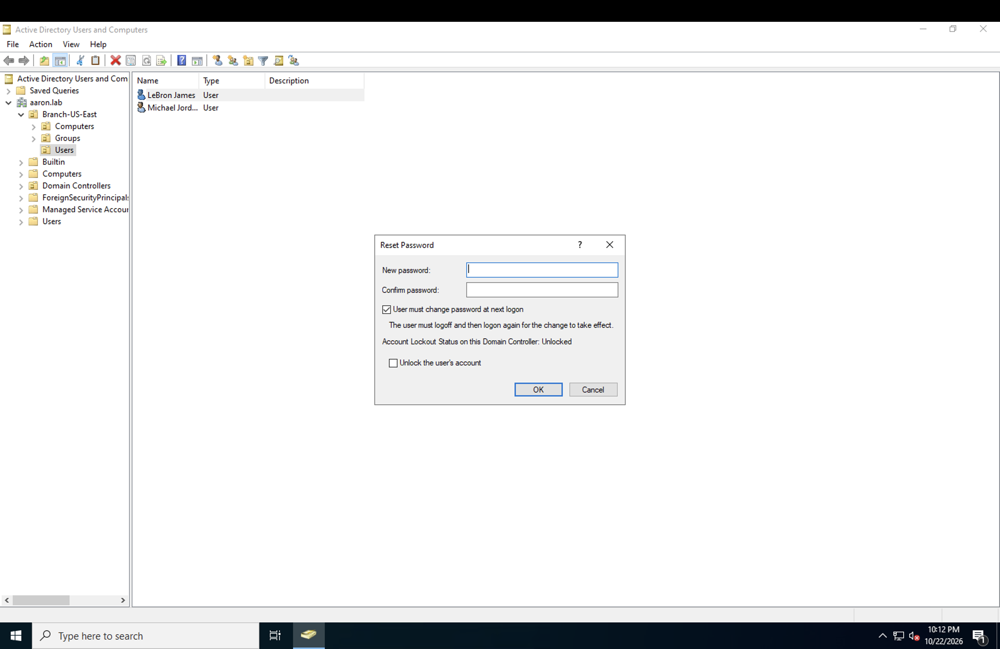

   

Create Group

   

Show Group Members

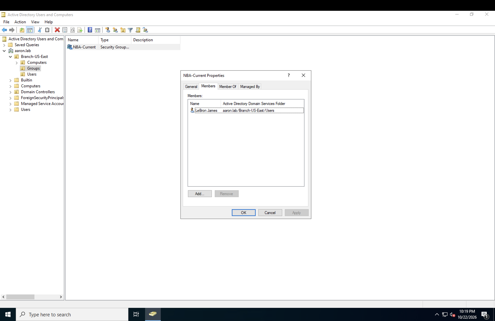

   

Copy User

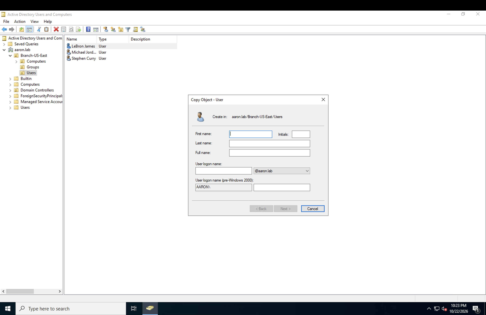

   

Unlock Account

   

Unlocked Account

   

Moving User

   

User Moved

   

Confirm User Moved

   

User Object Location

   

Create Client VM

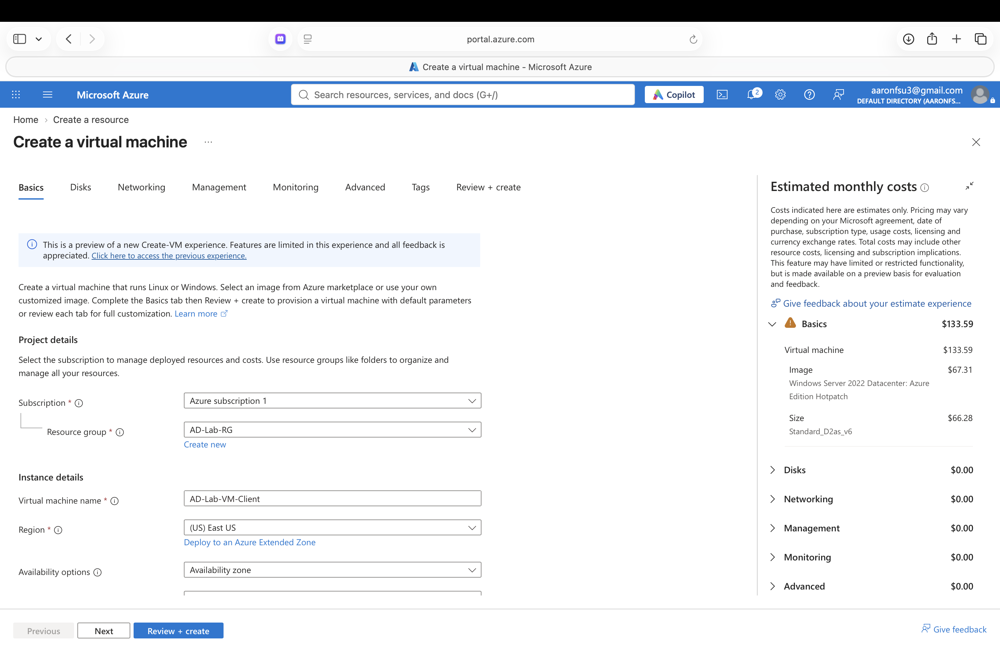

   

Client DNS Settings

   

Client Find Domain

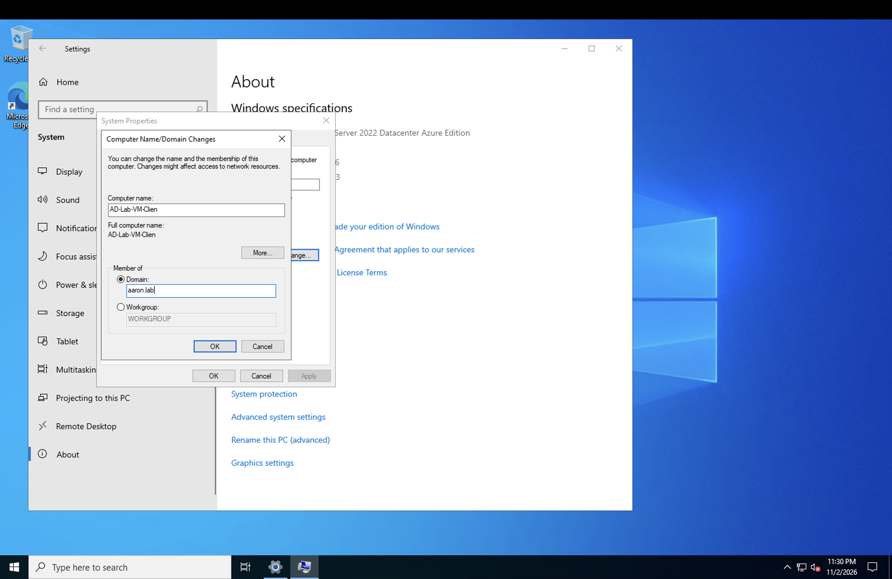

   

Client Attempt Join Domain

   

Client Join Domain

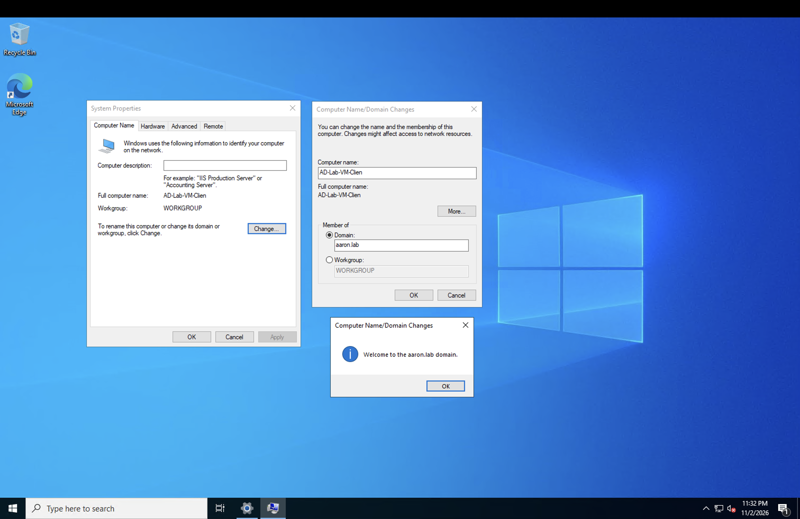

   

Ipconfig Command

   

Ping Domain Controller

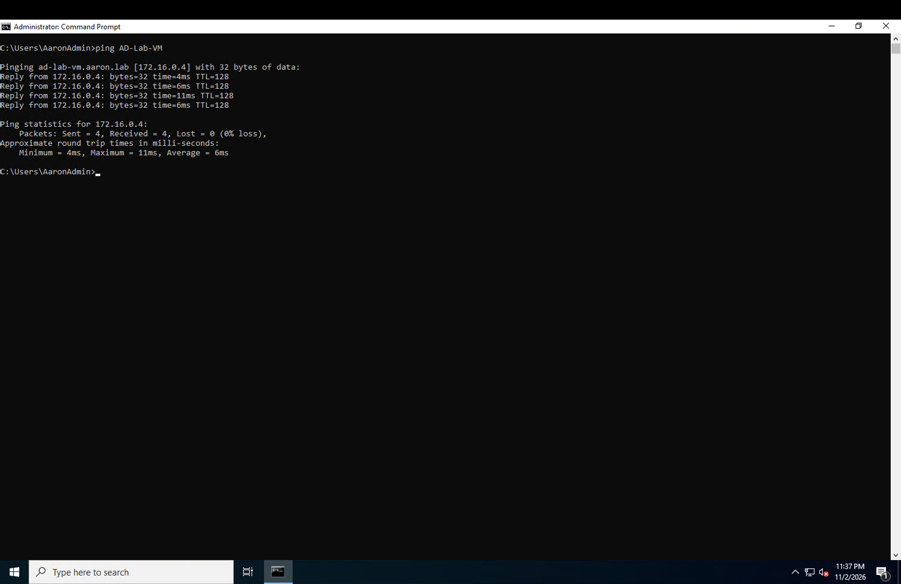

   
